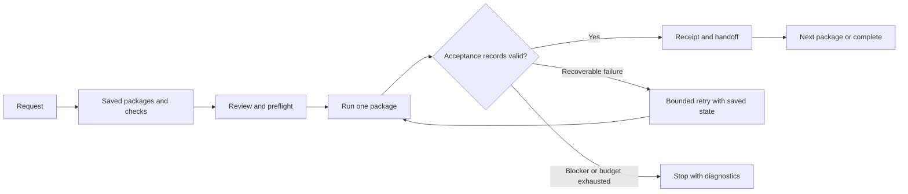

# Plan and Run

**Turn a coding request into a saved plan that Codex CLI can execute, pause and resume.**

Plan and Run is a Codex skill plus a dependency-free Node.js runner. It divides work into bounded packages, saves the requirements and acceptance checks, and runs one package at a time. Each completed package leaves a validation receipt and a handoff. Interrupted work keeps its state; recoverable failures use bounded retries.

Built by [Ahmed Elkayesh](https://github.com/aelkayesh) for a personal development workflow and released as an independent early project under [MIT](LICENSE). It is not affiliated with OpenAI. Passing orchestration tests is evidence about the runner's mechanics, not a guarantee of correct software or evidence of external adoption.



## What it does

- Saves a request, shared contract, package plans and a portable runner in your repository.
- Starts a fresh Codex conversation for each package and resumes saved conversations for ordinary retries.
- Preserves selected step/range boundaries, accepted work, cooldowns and retry budgets across restarts.
- Stops at missing prerequisites, explicit manual boundaries or exhausted budgets.
- Supports optional background execution and optional strict acceptance for a fixed TypeScript/Next.js stack.

The default mode validates completion records and declared checks. Strict mode adds frozen criteria, parent-run gates and fresh model review. Both still require thoughtful acceptance criteria and human judgment. Read [adapter scope and compatibility](references/compatibility.md) before selecting strict mode.

## Requirements

- macOS, Linux, or **Windows through WSL2**. See the [Windows setup and PowerShell launcher](references/windows.md). Native Windows Node.js execution is not supported.
- Node.js **22.13+** and Git. No npm dependencies are required for the core runner or test suite.
- Codex CLI with local authentication that the preflight probe supports. The CLI contract was checked against **0.167.0**.
- A target Git repository with an existing commit.

Real worker calls use your selected Codex account/provider and consume its quota or API budget. Preflight checks local readiness, not remote authorization. Arbitrary custom authentication helpers are not supported; see [compatibility](references/compatibility.md).

## See a resume without model calls

From a clone of this repository, run:

```sh
npm run demo
```

The demo creates a temporary Git repository, uses the real generator and runner with a deterministic fake worker, completes package 01, then resumes the range and runs package 02 only. It checks that the first receipt and attempt stay unchanged, runs real arithmetic assertions and removes its temporary files. It also checks that a generated bundle works after relocation before execution and removal of its generator copy.

This demonstrates selected-range resume, not interrupted-worker recovery, automatic retry behavior or AI implementation quality. No Codex login, model call or dependency installation is needed. See [the output](examples/demo-output.txt) and [the demo source](scripts/demo.mjs).

## Install the skill

On Windows, follow the [WSL2 setup](references/windows.md) and run the shell commands inside your Linux distribution.

Clone into your user skill directory. This command refuses to replace an existing installation, including a symlink:

```sh
(
  set -eu
  plan_and_run_dir="$HOME/.agents/skills/plan-and-run"
  if [ -e "$plan_and_run_dir" ] || [ -L "$plan_and_run_dir" ]; then
    printf '%s\n' "Already exists: $plan_and_run_dir. Review it before installing."
    exit 1
  fi
  mkdir -p "$HOME/.agents/skills"
  git clone https://github.com/aelkayesh/plan-and-run.git "$plan_and_run_dir"
)
```

Start a new Codex session in your target project, then ask:

> Use $plan-and-run to plan and implement a small feature. Save bounded packages with acceptance checks, execute them, and report the validation receipts.

For preparation without implementation:

> Use $plan-and-run to prepare a plan and runner for this feature. Do not start implementation; I will launch it myself.

The skill supports automatic discovery, but installation does not change your global `AGENTS.md` preferences. It respects planning-only requests, requested package ranges and existing authorization. To uninstall, remove only this clone or discovery link after checking for local changes; generated project bundles remain independent.

## Try the plan format

The included [two-package example](examples/text-utils.json) builds and tests a tiny text utility in a disposable repository. The following prepares the bundle without model calls:

```sh
plan_and_run_dir="$HOME/.agents/skills/plan-and-run"
example_repo="$(mktemp -d "${TMPDIR:-/tmp}/plan-and-run-example.XXXXXX")"
git init -b main "$example_repo"
git -C "$example_repo" -c user.name='Example User' \
  -c user.email='example@example.invalid' commit --allow-empty -m 'Initialize example'
node "$plan_and_run_dir/scripts/prepare.mjs" \
  --repo "$example_repo" --slug text-utils \
  --spec "$plan_and_run_dir/examples/text-utils.json"
cd "$example_repo"
node docs/implementation-plans/text-utils/run.mjs dry-run
node docs/implementation-plans/text-utils/run.mjs status
```

Review the generated request, shared contract, package plans and worker contract. Resolve omissions, then edit `docs/implementation-plans/text-utils/runner-manifest.json` to set `"ready": true`. Preparation never sets it for you.

Check the exact range before executing it:

```sh
node docs/implementation-plans/text-utils/run.mjs preflight --from 01 --to 02 --json
```

If preflight reports ready and you intend to run real Codex workers:

```sh
node docs/implementation-plans/text-utils/run.mjs start --from 01 --to 02
```

After an interruption, resume from the **same checkout** with the same range:

```sh
node docs/implementation-plans/text-utils/run.mjs resume --from 01 --to 02
```

Accepted packages are skipped; pending work and retry budgets are retained. Use `--step 01` for one package. Do not regenerate a plan or edit saved state to discard a failure. For your own feature, author a complete specification using [the plan format](references/plan-format.md).

## Operational boundaries

The default rate-limit retry budget is eight; transport retries are also bounded. `--max-rate-retries 0` explicitly opts into unlimited rate retries. Cooldowns and spent budgets survive restart. Exhaustion stops with diagnostics; it does not silently reset the budget or switch providers.

Foreground execution is the default. `launch` is an explicit background option with owned process cleanup; see [commands and recovery](references/runner-contract.md). On macOS it inhibits idle sleep while running. It does not install a service or promise survival across reboot, poweroff or closed-lid sleep.

Keep `.codex-plan-runner/` private. Raw logs can contain source and tool output; redaction is best effort. Generated plans and handoffs may also contain private details, so review them before publishing. Host-check environment scrubbing is not a security sandbox. A local coding request does not authorize deployment, external messages or unrelated paid calls.

## Development and feedback

From this repository:

```sh
npm run check
npm run demo
npm test
```

The suite uses temporary repositories and fake Codex workers; it does not call a model. CI covers Node 22 and 24 on macOS/Linux, plus native Windows tests for the PowerShell WSL2 launcher. Launcher tests use a fake WSL executable; they do not establish a complete WSL2 feature run. Consult the actual CI runs for results on a specific revision.

Useful feedback is a small reproducible case: a plan that did not resume as expected, a misleading diagnostic, or a missing adapter with a concrete use case. See [contributing](CONTRIBUTING.md), [security](SECURITY.md), [release notes](CHANGELOG.md) and the [full execution contract](references/runner-contract.md).
